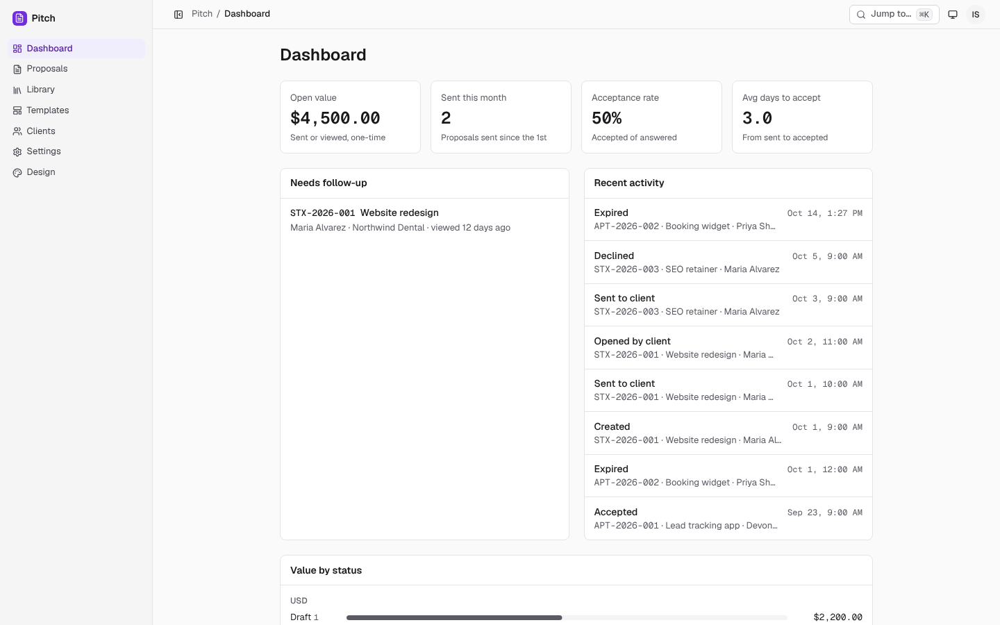
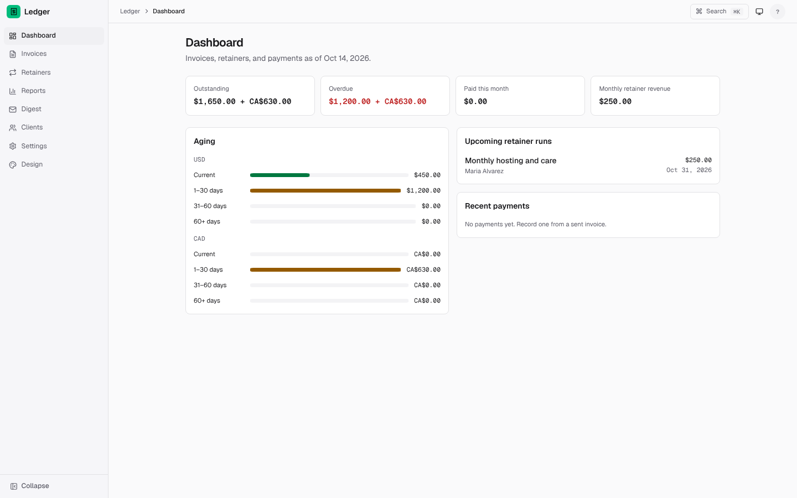
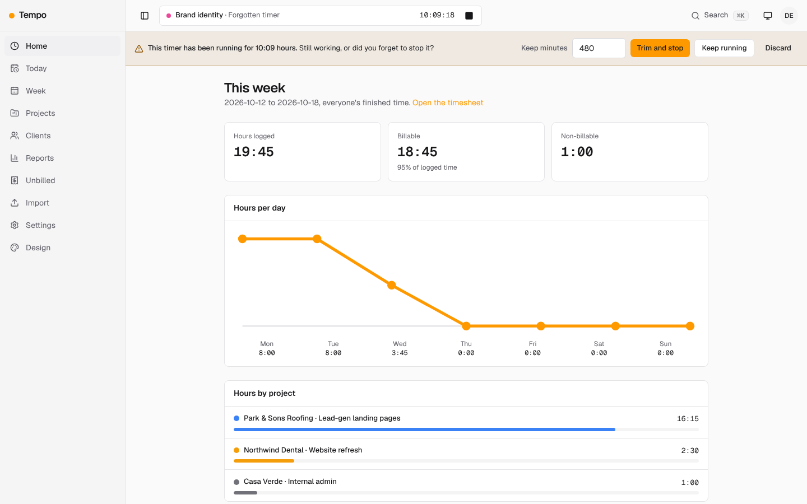
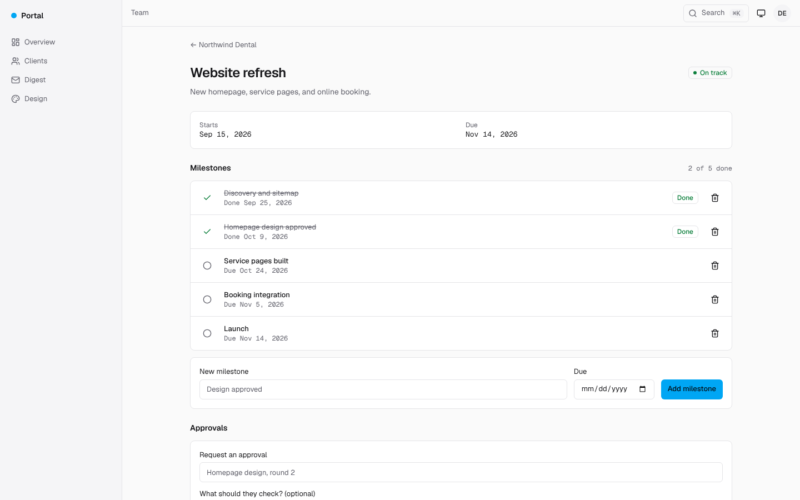
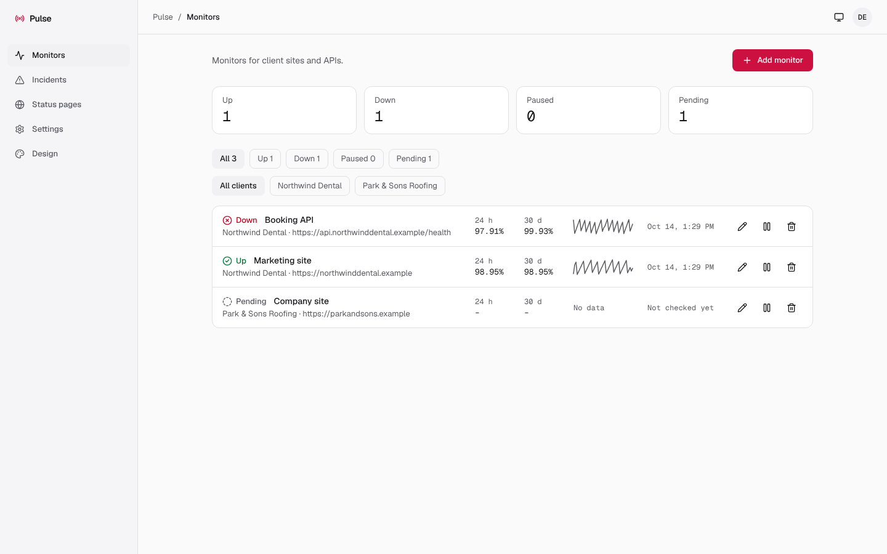

# Statixx Labs demo

Click-through demos of the business tools behind Statixx, Aptixx, and Trazo: proposals, invoicing, time tracking, client portals, and uptime monitoring.

**Live demo: [isaacxj.github.io/statixx-labs-demo](https://isaacxj.github.io/statixx-labs-demo/)**

Each tool is its own app running on Cloudflare (Workers, D1, R2) behind sign-in. This site lets anyone browse them without an account: every page is a snapshot of the real app loaded with sample clients, projects, and invoices.

## The tools

### Pitch: proposals and quotes

Build proposals from reusable sections and price tables, send clients a private link, see when they open it, and let them accept or decline.

[Open Pitch](https://isaacxj.github.io/statixx-labs-demo/pitch/) · [Client view](https://isaacxj.github.io/statixx-labs-demo/pitch/p/seedViewedQuietProposalToken0001/)

### Ledger: invoices, retainers, and payments

Invoices and retainers across all three businesses in USD and CAD, with aging, overdue tracking, and a shareable invoice page for clients.

[Open Ledger](https://isaacxj.github.io/statixx-labs-demo/ledger/) · [Client invoice](https://isaacxj.github.io/statixx-labs-demo/ledger/i/seedtoken00000000000000000000002/)

### Tempo: time tracking and profitability

Timers and timesheets against clients and projects, budget burn, effective hourly rate, and billable-time export.

[Open Tempo](https://isaacxj.github.io/statixx-labs-demo/tempo/)

### Portal: a private portal for each client

Project status, milestones, updates, shared files, approvals, and requests in one place instead of scattered email threads.

[Team view](https://isaacxj.github.io/statixx-labs-demo/portal/) · [Client view](https://isaacxj.github.io/statixx-labs-demo/portal-client/)

### Pulse: uptime monitoring and status pages

Monitors for client sites and APIs that confirm outages before alerting, with uptime history and a public status page per client.

[Open Pulse](https://isaacxj.github.io/statixx-labs-demo/pulse/) · [Status page](https://isaacxj.github.io/statixx-labs-demo/pulse/s/northwind-dental/)

## What to expect

- **Sample data only.** The businesses are real; the clients, projects, and amounts are made up.
- **Read-only.** Navigation, filters, and tabs work. Buttons and forms show a "changes aren't saved" note instead of doing anything.
- **Light and dark.** Use the Theme button in the demo bar at the bottom of each page.
- **Team and client sides.** Pitch, Ledger, Portal, and Pulse each have a client-facing page; the links above open both.
- **A snapshot.** Pages reflect the tools as of the date they were captured, so dates and "this week" views are fixed to that day.
